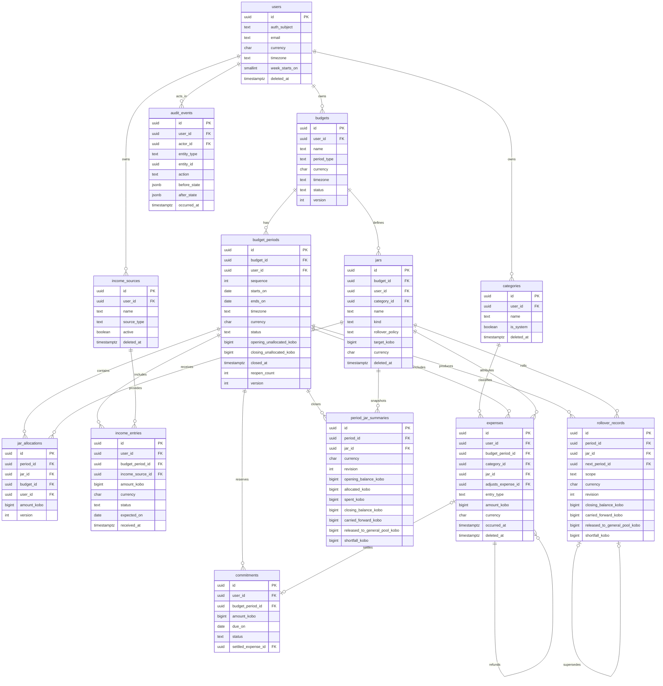

# PAYJAR Database Domain Model

**Version:** 1.0  
**Date:** 2 November 2026  
**Status:** Approved design for implementation (Ticket DB-01)  

---

## 1. Purpose and scope

This document translates the approved budgeting rules and the existing calculation engine into a database domain model. It is the design input for Ticket DB-02 (schema implementation).

It defines:

- The entities required for budgeting.
- How those entities relate to each other and to the existing user/wallet code.
- Primary keys, foreign keys, unique constraints and validation rules.
- Which data is soft-deleted, immutable, snapshotted or normally updated.
- How money is stored.
- How the model feeds the existing calculation functions.
- The decisions required by section 7 of the implementation guide.

This ticket does **not** create or change database tables. The target schema is implemented in DB-02 and applied through migrations in DB-03.

---

## 2. Sources reviewed

- `database/schema.sql` — current wallet, transaction, ledger and idempotency schema.
- `src/budgeting/calculations.ts` — flexible pool, allocation funding, jar balance and daily guidance.
- `src/budgeting/rollover.ts` — per-jar rollover behaviour.
- `src/budgeting/money.ts` — kobo representation and parsing rules.
- `src/budgeting/periods.ts` — calendar-date period arithmetic.
- `src/budgeting/types.ts` — calculation input types.
- `src/service.ts` and `src/domain.ts` — current wallet behaviour and naming conventions.
- `docs/PRD.md`, `docs/TRD.md`, `docs/IMPLEMENTATION-ROADMAP.md`.
- `Implementation guide.md`, tickets DB-01 to DB-09.

---

## 3. Assessment of the existing schema

### 3.1 Existing tables

| Table | Purpose | Relevance to budgeting |
|---|---|---|
| `wallets` | One wallet per `user_id` (text), numeric balance | Legacy wallet module. Not a planning jar. |
| `transactions` | Deposits and wallet-to-wallet transfers | Legacy wallet module. Not income/expense records. |
| `ledger_entries` | Debit/credit entries for wallet transactions | Legacy wallet module. Not budget allocations. |
| `idempotency_keys` | `(scope, key)` retry cache | Generic enough to reuse for retry-safe budget writes. |

Important findings:

1. **There is no `users` table.** `wallets.user_id` is unconstrained text, and the wallet API accepts a caller-supplied user ID. The budgeting module needs a real identity record before it can enforce ownership.
2. **Wallet balances use `numeric(18,2)` and are converted to JavaScript `Number`.** This is not acceptable for budgeting calculations. New budgeting tables must use integer kobo.
3. **Wallet money is real-money movement; jars are virtual planning allocations.** Reusing `wallets` or `ledger_entries` for jars would duplicate and misrepresent the product.
4. **Idempotency is wallet-oriented but table-shaped generically.** It can be reused with budgeting-specific scopes rather than creating a second idempotency table.

### 3.2 Integration decision

- Add a canonical `users` table as the owner of all budgeting records.
- Budgeting tables reference `users.id` (UUID). They do **not** reference `wallets`.
- Leave the existing wallet tables untouched in DB-02/DB-03. The wallet module remains isolated and disabled for the Stage 1 product API, as directed by the TRD.
- A virtual jar is never a wallet, a bank account or a stored-value balance. Budgeting must never read or write `wallets.balance`.
- If real-money wallets are reactivated later, the integration seam is `users.id`. Wallet ownership must first be migrated from free-text `user_id` to a UUID foreign key. That migration is out of scope for this phase.
- The existing `idempotency_keys` table may be reused for budget create operations with scopes such as `budgeting:expense`. This avoids a duplicate idempotency subsystem.

The resulting boundary is:

```text
users ──► budgets ──► budget_periods ──► financial records
  │
  └── (future, explicit migration) ──► wallets / real-money module
```

There is no database relationship between budgeting and the wallet ledger.

---

## 4. Resolved design decisions

These resolve section 7 of the implementation guide ("Important Technical Decisions to Resolve Before Coding").

| ID | Decision | Resolution |
|---|---|---|
| D1 | Budget period structure | One active budget per user (database-enforced). A budget has many explicit periods. Each period stores `starts_on`/`ends_on` as `DATE` plus the timezone snapshot. Monthly/weekly/yearly periods are explicit ranges and may start on a payday rather than the 1st. `period_type` only describes the recurrence used to propose the next period. Overlapping periods are rejected. |
| D2 | Financial record ownership | Income belongs to a budget period, not a jar. Expenses belong to a period and **optionally** to a jar. Commitments belong to a period and are never jar allocations. Allocations are the only mechanism that moves money into a jar. See section 10 for double-count rules. |
| D3 | Historical snapshots | Period opening funds, closing totals and per-jar closing/rollover results are snapshotted. Active-period balances remain derived. Audit rows and rollover rows are append-only. See section 9. |
| D4 | Closed-period edits | A closed period must be explicitly reopened. Reopening is audited. Re-closing recomputes summaries and creates superseding rollover revisions. Later periods are corrected through compensating adjustments, never by silently rewriting prior rollover history. |
| D5 | Concurrency | Mutable aggregates carry an integer `version` for optimistic checks. Period close and rollover lock the period row with `SELECT … FOR UPDATE`. Partial unique indexes provide a database backstop for "one active budget", "one active period" and "one current rollover revision". |
| D6 | Audit design | Full before/after JSON for every financial record change; changed-field before/after for configuration changes. Audit rows are written in the same transaction as the change and are never updated or deleted. See section 12. |
| D7 | Migration tooling | Versioned SQL migrations, selected in DB-03. This ticket only defines the model. `database/schema.sql` must stop being the long-term migration mechanism. |
| D8 | Wallet integration | Budgeting uses `users` only. It does not duplicate wallets as jars and does not use wallet balances as plan funds. |

---

## 5. Conventions

- **Primary keys:** UUID, generated by the database (`gen_random_uuid()`).
- **Ownership:** every budgeting aggregate carries `user_id`. Composite foreign keys enforce that a child links to a parent owned by the same user and, where relevant, the same budget.
- **Calendar dates:** PostgreSQL `DATE` for period boundaries, due dates and expected dates (`starts_on`, `ends_on`, `due_on`, `expected_on`).
- **Event timestamps:** `TIMESTAMPTZ` in UTC (`created_at`, `updated_at`, `occurred_at`, `closed_at`).
- **Money:** `BIGINT` kobo. Signed only for balances. See section 8.
- **Currency:** `CHAR(3)` on every money-bearing record. MVP enforces `NGN`.
- **Deletion:** soft delete with `deleted_at` for records users can remove. Financial facts are retained. No cascading hard deletes. See section 11.
- **Concurrency:** `version INTEGER NOT NULL DEFAULT 1` on mutable records, incremented on update.
- **Timestamps:** `created_at` and `updated_at` default to `now()`; `updated_at` is set by the repository on update.
- **Naming:** snake_case in SQL, camelCase in TypeScript.

---

## 6. Entity catalogue

The entity list below is final for this phase. Four supporting entities are added to the ticket's proposed list because the approved rules require them:

- `users` — ownership and identity.
- `categories` — PRD requires categorised expenses and custom categories.
- `income_sources` — PRD requires multiple income sources and a source type per income record.
- `period_jar_summaries` — immutable close snapshots required by D3/D4.

### 6.1 `users`

**Purpose:** Canonical owner for all budgeting records and trusted identity mapping.

| Column | Type | Null | Notes |
|---|---|---|---|
| `id` | UUID | no | PK |
| `auth_subject` | TEXT | no | Unique identity-provider subject |
| `email` | TEXT | yes | Unique on `lower(email)` where present |
| `phone` | TEXT | yes | |
| `display_name` | TEXT | no | Non-empty |
| `currency` | CHAR(3) | no | Default `NGN`; MVP allows NGN only |
| `timezone` | TEXT | no | IANA timezone, default `Africa/Lagos` |
| `week_starts_on` | SMALLINT | no | Default `1` (Monday); 0–6 |
| `version` | INTEGER | no | Default 1 |
| `created_at` | TIMESTAMPTZ | no | |
| `updated_at` | TIMESTAMPTZ | no | |
| `deleted_at` | TIMESTAMPTZ | yes | Soft delete / deletion workflow |

**Constraints and indexes**

- PK `(id)`.
- Unique `(auth_subject)`.
- Unique index on `lower(email)` where `email IS NOT NULL` and `deleted_at IS NULL`.
- Check `currency ~ '^[A-Z]{3}$'`, `week_starts_on BETWEEN 0 AND 6`.
- Check `length(btrim(display_name)) > 0`.

**Lifecycle:** normal profile updates; soft delete only. Financial records keep the `user_id` reference.

### 6.2 `budgets`

**Purpose:** A user's planning configuration. Budgets are long-lived; periods are the dated instances.

| Column | Type | Null | Notes |
|---|---|---|---|
| `id` | UUID | no | PK |
| `user_id` | UUID | no | FK `users(id)` |
| `name` | TEXT | no | Non-empty |
| `period_type` | TEXT | no | `daily`, `weekly`, `monthly`, `yearly`, `custom` |
| `currency` | CHAR(3) | no | Default `NGN` |
| `timezone` | TEXT | no | Snapshot at creation; drives period boundaries |
| `status` | TEXT | no | `active`, `archived`; default `active` |
| `version` | INTEGER | no | Default 1 |
| `created_at`, `updated_at` | TIMESTAMPTZ | no | |
| `deleted_at` | TIMESTAMPTZ | yes | Soft delete |

**Constraints and indexes**

- PK `(id)`.
- Unique `(id, user_id)` to support composite ownership FKs.
- **One active budget per user:** unique index `(user_id) WHERE status = 'active' AND deleted_at IS NULL`.
- Check `period_type IN (...)`, `status IN (...)`, `length(btrim(name)) > 0`.
- Index `(user_id, status)`.

**Lifecycle:** configuration updates are audited. Archive instead of delete when periods exist. Soft delete only.

**Period recurrence:** `period_type` is a proposal rule, not an independent source of dates. Actual periods use explicit `starts_on`/`ends_on`, so a monthly plan can run from payday to the day before the next payday.

### 6.3 `budget_periods`

**Purpose:** A dated instance of a budget. All financial records belong to a period.

| Column | Type | Null | Notes |
|---|---|---|---|
| `id` | UUID | no | PK |
| `budget_id` | UUID | no | FK `budgets(id)` |
| `user_id` | UUID | no | Denormalised owner; composite FKs |
| `sequence` | INTEGER | no | 1-based order within the budget |
| `name` | TEXT | yes | e.g. "November 2026" |
| `starts_on` | DATE | no | Inclusive, local date |
| `ends_on` | DATE | no | Inclusive, local date |
| `timezone` | TEXT | no | Snapshot of budget timezone |
| `currency` | CHAR(3) | no | Snapshot of budget currency; default `NGN` |
| `status` | TEXT | no | `draft`, `active`, `closed`; default `draft` |
| `opening_unallocated_kobo` | BIGINT | no | Signed general-pool opening funds; default 0 |
| `closing_unallocated_kobo` | BIGINT | yes | Signed close snapshot; set only on close |
| `total_income_kobo` | BIGINT | yes | Close snapshot; `>= 0` |
| `total_expense_kobo` | BIGINT | yes | Close snapshot; net of refunds |
| `total_allocated_kobo` | BIGINT | yes | Close snapshot; `>= 0` |
| `total_released_kobo` | BIGINT | yes | Released from jars; `>= 0` |
| `total_carried_kobo` | BIGINT | yes | Carried jar balances; signed |
| `total_shortfall_kobo` | BIGINT | yes | `>= 0` |
| `closed_at` | TIMESTAMPTZ | yes | |
| `closed_by` | UUID | yes | FK `users(id)` |
| `reopened_at` | TIMESTAMPTZ | yes | Latest reopen |
| `reopen_count` | INTEGER | no | Default 0 |
| `version` | INTEGER | no | Default 1 |
| `created_at`, `updated_at` | TIMESTAMPTZ | no | |

**Constraints and indexes**

- PK `(id)`.
- Unique `(id, user_id)`, `(id, budget_id)` and `(id, budget_id, user_id)` for composite FKs.
- FK `(budget_id, user_id)` → `budgets(id, user_id)`. This prevents a period from being attached to another user's budget.
- Unique `(budget_id, sequence)`.
- Unique `(budget_id, starts_on)`.
- **One active period per budget:** unique index `(budget_id) WHERE status = 'active'`.
- Check `ends_on >= starts_on`.
- Check `status IN ('draft', 'active', 'closed')`.
- Check close amount consistency: either `status = 'closed'` and all close amount fields are present, or all close amount fields are null. (`closed_at` may remain as the last close timestamp after a reopen.)
- **No overlapping periods:** `EXCLUDE USING gist (budget_id WITH =, daterange(starts_on, ends_on, '[]') WITH &&)` using the `btree_gist` extension. DB-02 implements this as `budget_periods_no_overlap` in `database/schema.postgres.sql`.
- Index `(budget_id, starts_on DESC)`, `(user_id, status)`.

**Lifecycle**

- `draft` may be edited.
- `active` may receive income, expenses, commitments and allocation changes.
- `closed` is immutable except through an explicit reopen workflow.
- Periods are never hard-deleted once they contain financial records.
- Reopening is allowed only for the most recent closed period when no later period is active or closed. This is a service rule enforced under a row lock and recorded in `audit_events`.
- Reopening clears the close amount snapshots on `budget_periods`; the previous snapshot remains in `period_jar_summaries` and `audit_events`. `closed_at` is retained as the last close timestamp.
- `opening_unallocated_kobo` is a snapshot. It is set when the period is created and is not recomputed from later records.

### 6.4 `jars`

**Purpose:** A named virtual allocation inside a budget. A jar is a planning bucket, never a bank account or wallet.

| Column | Type | Null | Notes |
|---|---|---|---|
| `id` | UUID | no | PK |
| `budget_id` | UUID | no | FK `budgets(id)` |
| `user_id` | UUID | no | Composite ownership |
| `name` | TEXT | no | Non-empty |
| `kind` | TEXT | no | `savings`, `standard` |
| `rollover_policy` | TEXT | no | `carry_forward`, `release_to_general_pool` |
| `category_id` | UUID | yes | Optional category-budget link |
| `target_kobo` | BIGINT | yes | Optional target; `>= 0` |
| `currency` | CHAR(3) | no | Default `NGN` |
| `sort_order` | INTEGER | no | Default 0 |
| `version` | INTEGER | no | Default 1 |
| `created_at`, `updated_at` | TIMESTAMPTZ | no | |
| `deleted_at` | TIMESTAMPTZ | yes | Archive / soft delete |

**Constraints and indexes**

- PK `(id)`.
- Unique `(id, user_id)`, `(id, budget_id)` and `(id, budget_id, user_id)` for composite FKs.
- FK `(budget_id, user_id)` → `budgets(id, user_id)`.
- FK `category_id` → `categories(id)`; the service must validate that the category is a system category or belongs to the same user.
- Unique index `(budget_id, lower(name)) WHERE deleted_at IS NULL`.
- Unique index `(budget_id, category_id) WHERE category_id IS NOT NULL AND deleted_at IS NULL` (one category budget per category).
- Check `kind IN ('savings','standard')`, `rollover_policy IN (...)`, `target_kobo IS NULL OR target_kobo >= 0`.
- Index `(budget_id, sort_order)`.

**Rules**

- Default rollover is derived from `kind` using `getDefaultRolloverPolicy`: savings → `carry_forward`, standard → `release_to_general_pool`. Users may override per jar.
- `eligibleForDailyGuidance` is **derived**, not stored: standard jars are eligible; savings jars are protected.
- A jar linked to a category acts as the category budget for that category.
- A jar with financial history is archived, never hard-deleted.

### 6.5 `jar_allocations`

**Purpose:** Records the amount allocated to a jar for a period. This is the only operation that moves money into a jar.

| Column | Type | Null | Notes |
|---|---|---|---|
| `id` | UUID | no | PK |
| `user_id` | UUID | no | Composite ownership |
| `budget_id` | UUID | no | Composite scope |
| `period_id` | UUID | no | FK `budget_periods(id)` |
| `jar_id` | UUID | no | FK `jars(id)` |
| `amount_kobo` | BIGINT | no | `>= 0`; zero means no current allocation |
| `currency` | CHAR(3) | no | Default `NGN` |
| `note` | TEXT | yes | |
| `version` | INTEGER | no | Default 1 |
| `created_at`, `updated_at` | TIMESTAMPTZ | no | |

**Constraints and indexes**

- PK `(id)`.
- Composite FKs `(period_id, budget_id, user_id)` → `budget_periods(id, budget_id, user_id)` and `(jar_id, budget_id, user_id)` → `jars(id, budget_id, user_id)`. This guarantees the period and jar belong to the same budget and user.
- Unique `(period_id, jar_id)` — one current allocation per jar per period.
- Check `amount_kobo >= 0`.
- Index `(period_id)`, `(jar_id, period_id)`.

**Lifecycle**

- Mutable while the period is `draft` or `active`, under optimistic version checks and audit.
- Setting an allocation to zero is the supported way to remove it. Rows are not deleted.
- Immutable after close. Changes require a period reopen and create a superseding close snapshot.

### 6.6 `period_jar_summaries`

**Purpose:** Immutable close-time snapshot of each jar's position and rollover result for a period.

| Column | Type | Null | Notes |
|---|---|---|---|
| `id` | UUID | no | PK |
| `user_id` | UUID | no | Composite ownership |
| `budget_id` | UUID | no | Composite scope |
| `period_id` | UUID | no | FK `budget_periods(id)` |
| `jar_id` | UUID | no | FK `jars(id)` |
| `currency` | CHAR(3) | no | Snapshot of budget currency |
| `revision` | INTEGER | no | Default 1 |
| `opening_balance_kobo` | BIGINT | no | Carried in from previous period |
| `allocated_kobo` | BIGINT | no | `>= 0` |
| `spent_kobo` | BIGINT | no | Net of refunds |
| `closing_balance_kobo` | BIGINT | no | Signed; may be negative |
| `rollover_policy` | TEXT | no | Snapshot of policy used |
| `carried_forward_kobo` | BIGINT | no | Signed; next opening balance |
| `released_to_general_pool_kobo` | BIGINT | no | `>= 0` |
| `shortfall_kobo` | BIGINT | no | `>= 0`; `max(0, -closing)` |
| `computed_at` | TIMESTAMPTZ | no | |
| `superseded_at` | TIMESTAMPTZ | yes | Set when a new revision is created |
| `superseded_by_id` | UUID | yes | Self-reference |

**Constraints and indexes**

- PK `(id)`.
- Composite FKs to period and jar, including `budget_id` and `user_id`.
- Unique `(period_id, jar_id, revision)`.
- Unique index `(period_id, jar_id) WHERE superseded_at IS NULL` — one current summary per jar per period.
- Check `allocated_kobo >= 0`, `released_to_general_pool_kobo >= 0`, `shortfall_kobo >= 0`.
- Check `carried_forward_kobo = closing_balance_kobo - released_to_general_pool_kobo`.
- Check `shortfall_kobo = GREATEST(0, -closing_balance_kobo)`.
- Index `(period_id)`, `(jar_id, period_id DESC)`.

**Why this is stored rather than derived:** closing balances and rollover outcomes are financial facts. Later corrections to a closed period must not silently change history. Revisions preserve the previous snapshot.

### 6.7 `income_sources`

**Purpose:** Optional named source for income (salary, business, freelance, gift, other).

| Column | Type | Null | Notes |
|---|---|---|---|
| `id` | UUID | no | PK |
| `user_id` | UUID | no | FK `users(id)` |
| `name` | TEXT | no | Non-empty |
| `source_type` | TEXT | no | `salary`, `business`, `freelance`, `gift`, `other` |
| `active` | BOOLEAN | no | Default `true` |
| `created_at`, `updated_at` | TIMESTAMPTZ | no | |
| `deleted_at` | TIMESTAMPTZ | yes | Soft delete |

**Constraints and indexes**

- PK `(id)`; unique `(id, user_id)`.
- Unique index `(user_id, lower(name)) WHERE deleted_at IS NULL`.
- Check `source_type IN (...)`.
- Index `(user_id, active)`.

**Lifecycle:** normal updates and soft delete. Soft delete is required because income records retain the reference.

### 6.8 `income_entries`

**Purpose:** Expected, received or cancelled income recorded against a budget period.

| Column | Type | Null | Notes |
|---|---|---|---|
| `id` | UUID | no | PK |
| `user_id` | UUID | no | Composite ownership |
| `budget_period_id` | UUID | no | FK `budget_periods(id)` |
| `income_source_id` | UUID | yes | FK `income_sources(id)` |
| `amount_kobo` | BIGINT | no | `> 0` |
| `currency` | CHAR(3) | no | Default `NGN` |
| `status` | TEXT | no | `expected`, `received`, `cancelled` |
| `expected_on` | DATE | yes | |
| `received_at` | TIMESTAMPTZ | yes | Required when received |
| `note` | TEXT | yes | |
| `version` | INTEGER | no | Default 1 |
| `created_at`, `updated_at` | TIMESTAMPTZ | no | |
| `deleted_at` | TIMESTAMPTZ | yes | Soft delete |

**Constraints and indexes**

- PK `(id)`.
- Composite FK `(budget_period_id, user_id)` → `budget_periods(id, user_id)`.
- Composite FK `(income_source_id, user_id)` → `income_sources(id, user_id)` when the source is present.
- Check `amount_kobo > 0`.
- Check `status IN ('expected','received','cancelled')`.
- Check `(status <> 'received') OR received_at IS NOT NULL`.
- Index `(user_id, received_at DESC)`, `(budget_period_id, status)`, `(income_source_id)`.

**Ownership rule:** income belongs to the period. It is not attached directly to a jar; jar allocations decide how the income is divided. Expected income is never counted as available funds.

**Lifecycle:** create/edit/soft delete. Corrections on received income are audited. Hard delete is never allowed.

### 6.9 `categories`

**Purpose:** Expense classification for reporting and category budgets. System categories and user-defined categories share this table.

| Column | Type | Null | Notes |
|---|---|---|---|
| `id` | UUID | no | PK |
| `user_id` | UUID | yes | `NULL` for system categories |
| `name` | TEXT | no | Non-empty |
| `icon_key` | TEXT | yes | |
| `is_system` | BOOLEAN | no | Default `false` |
| `created_at`, `updated_at` | TIMESTAMPTZ | no | |
| `deleted_at` | TIMESTAMPTZ | yes | Soft delete |

**Constraints and indexes**

- PK `(id)`; unique `(id, user_id)`.
- Check `is_system = (user_id IS NULL)`.
- Unique index on `lower(name)` where `user_id IS NULL AND deleted_at IS NULL` (system names).
- Unique index `(user_id, lower(name)) WHERE user_id IS NOT NULL AND deleted_at IS NULL`.
- Index `(user_id)`.

**Lifecycle:** users may create, rename and soft-delete their own categories. System categories are read-only. Expenses retain category references after soft delete.

### 6.10 `expenses`

**Purpose:** Spending against a budget period, optionally attributed to a jar. Refunds are linked reversal rows, not silent deletions.

| Column | Type | Null | Notes |
|---|---|---|---|
| `id` | UUID | no | PK |
| `user_id` | UUID | no | Composite ownership |
| `budget_period_id` | UUID | no | FK `budget_periods(id)` |
| `category_id` | UUID | no | FK `categories(id)` |
| `jar_id` | UUID | yes | Optional jar attribution |
| `entry_type` | TEXT | no | `expense` or `refund`; default `expense` |
| `adjusts_expense_id` | UUID | yes | Original expense for a refund |
| `amount_kobo` | BIGINT | no | `> 0` |
| `currency` | CHAR(3) | no | Default `NGN` |
| `merchant` | TEXT | yes | |
| `note` | TEXT | yes | |
| `payment_method` | TEXT | yes | |
| `occurred_at` | TIMESTAMPTZ | no | Event time in UTC |
| `source` | TEXT | no | `manual`, `imported`; default `manual` |
| `version` | INTEGER | no | Default 1 |
| `created_at`, `updated_at` | TIMESTAMPTZ | no | |
| `deleted_at` | TIMESTAMPTZ | yes | Soft delete |

**Constraints and indexes**

- PK `(id)`; unique `(id, user_id)`.
- Composite FK `(budget_period_id, user_id)` → `budget_periods(id, user_id)`.
- Composite FK `(jar_id, user_id)` → `jars(id, user_id)` when present.
- FK `category_id` → `categories(id)`; the service must validate that the category is a system category or belongs to the same user.
- Composite self FK `(adjusts_expense_id, user_id)` → `expenses(id, user_id)` when present, so a refund cannot reference another user's expense.
- Check `amount_kobo > 0`.
- Check `entry_type IN ('expense','refund')`.
- Check `(entry_type = 'refund') = (adjusts_expense_id IS NOT NULL)`.
- Check `source IN ('manual','imported')`.
- Index `(user_id, occurred_at DESC)`, `(user_id, category_id, occurred_at DESC)`, `(budget_period_id, jar_id)`, `(jar_id)`.

**Rules**

- An expense is counted once: against the jar when `jar_id` is present, otherwise against the period's unallocated pool.
- When the category has a linked jar and the request omits `jar_id`, the service records that jar as `jar_id`. An expense is never counted against both a jar and the general pool.
- A refund reduces the same dimension as its original expense and must not delete or mutate the original row.
- `occurred_at` must fall inside the period's local date range. Because this depends on the period timezone, it is validated in the service/repository and not with a simple `CHECK`.
- Soft delete is an audited cancellation; the row remains for history.

### 6.11 `commitments`

**Purpose:** Money reserved for a known future obligation in a period.

| Column | Type | Null | Notes |
|---|---|---|---|
| `id` | UUID | no | PK |
| `user_id` | UUID | no | Composite ownership |
| `budget_period_id` | UUID | no | FK `budget_periods(id)` |
| `name` | TEXT | no | Non-empty |
| `amount_kobo` | BIGINT | no | `> 0` |
| `currency` | CHAR(3) | no | Default `NGN` |
| `due_on` | DATE | no | Local due date |
| `status` | TEXT | no | `planned`, `paid`, `cancelled` |
| `recurrence_rule` | TEXT | yes | Reserved for later recurring jobs |
| `paid_at` | TIMESTAMPTZ | yes | |
| `settled_expense_id` | UUID | yes | Expense that settled the commitment |
| `version` | INTEGER | no | Default 1 |
| `created_at`, `updated_at` | TIMESTAMPTZ | no | |
| `deleted_at` | TIMESTAMPTZ | yes | Soft delete |

**Constraints and indexes**

- PK `(id)`; unique `(id, user_id)`.
- Composite FK `(budget_period_id, user_id)` → `budget_periods(id, user_id)`.
- Composite FK `(settled_expense_id, user_id)` → `expenses(id, user_id)` when present.
- Unique index `(settled_expense_id) WHERE settled_expense_id IS NOT NULL` — one expense settles at most one commitment.
- Check `amount_kobo > 0`, `status IN ('planned','paid','cancelled')`.
- Check `(status <> 'paid') OR paid_at IS NOT NULL`.
- Index `(user_id, due_on, status)`, `(budget_period_id, status)`.

**Double-count rule:** commitments are a separate reservation mechanism. They are **not** jar allocations and must not also be represented by an allocation to a jar. Only `status = 'planned'` commitments are reserved in the flexible pool. A paid commitment may link to the expense that settled it; that expense is counted once as spending.

### 6.12 `rollover_records`

**Purpose:** Append-only record of the rollover applied when a period closes. One row per jar plus one general-pool row per close revision.

| Column | Type | Null | Notes |
|---|---|---|---|
| `id` | UUID | no | PK |
| `user_id` | UUID | no | Composite ownership |
| `budget_id` | UUID | no | Composite scope |
| `period_id` | UUID | no | Closing period |
| `jar_id` | UUID | yes | `NULL` only for `general_pool` |
| `scope` | TEXT | no | `jar`, `general_pool` |
| `currency` | CHAR(3) | no | Snapshot of budget currency |
| `revision` | INTEGER | no | Default 1 |
| `policy` | TEXT | yes | `NULL` for general pool |
| `closing_balance_kobo` | BIGINT | no | Signed |
| `carried_forward_kobo` | BIGINT | no | Signed; next opening |
| `released_to_general_pool_kobo` | BIGINT | no | `>= 0` |
| `shortfall_kobo` | BIGINT | no | `>= 0` |
| `next_period_id` | UUID | yes | Period receiving the result |
| `superseded_at` | TIMESTAMPTZ | yes | Set when a new revision is created |
| `superseded_by_id` | UUID | yes | Self-reference |
| `created_at` | TIMESTAMPTZ | no | |
| `created_by` | UUID | no | FK `users(id)` |

**Constraints and indexes**

- PK `(id)`.
- Composite FKs to `period_id`, `next_period_id`, `jar_id` including `budget_id` and `user_id`.
- Check `scope IN ('jar','general_pool')`.
- Check `(scope = 'jar') = (jar_id IS NOT NULL)`.
- Check `(scope = 'general_pool') = (policy IS NULL)`.
- Check `released_to_general_pool_kobo >= 0`, `shortfall_kobo >= 0`.
- Check `carried_forward_kobo = closing_balance_kobo - released_to_general_pool_kobo`.
- Check `shortfall_kobo = GREATEST(0, -closing_balance_kobo)`.
- Unique index `(period_id, jar_id, revision) WHERE scope = 'jar'`.
- Unique index `(period_id, revision) WHERE scope = 'general_pool'`. (`jar_id` is `NULL` in the general row, so a plain unique constraint would not catch duplicates.)
- Unique index `(period_id, jar_id) WHERE scope = 'jar' AND superseded_at IS NULL`.
- Unique index `(period_id) WHERE scope = 'general_pool' AND superseded_at IS NULL`.
- Index `(period_id)`, `(budget_id, revision)`.

**Rollover semantics**

- Standard jars default to `release_to_general_pool`; savings jars default to `carry_forward`.
- A positive unused balance follows the jar policy.
- A negative balance is retained as a shortfall (`carried_forward_kobo` remains negative); it is never written off or moved to another jar.
- The general-pool row records the closing unallocated balance, including any general-pool shortfall. The next period's `opening_unallocated_kobo` is:
  - general-pool `carried_forward_kobo`, plus
  - the sum of jar rows' `released_to_general_pool_kobo`.
- Rollover rows are immutable. A re-close creates new revisions and marks the previous rows `superseded_at`.

### 6.13 `audit_events`

**Purpose:** Append-only history of material changes to financial and configuration records.

| Column | Type | Null | Notes |
|---|---|---|---|
| `id` | UUID | no | PK |
| `user_id` | UUID | no | Owner/actor scope |
| `actor_type` | TEXT | no | `user`, `system` |
| `actor_id` | UUID | yes | Actor user ID for user actions |
| `entity_type` | TEXT | no | e.g. `expense`, `budget_period` |
| `entity_id` | UUID | no | Affected record |
| `action` | TEXT | no | e.g. `expense.updated` |
| `before_state` | JSONB | yes | Full record or changed fields |
| `after_state` | JSONB | yes | Full record or changed fields |
| `reason` | TEXT | yes | Required for corrections/reopens |
| `request_id` | TEXT | yes | Correlation with request logs |
| `occurred_at` | TIMESTAMPTZ | no | Default `now()` |

**Constraints and indexes**

- PK `(id)`.
- FK `user_id` → `users(id)`, `actor_id` → `users(id)` (nullable).
- Check `actor_type IN ('user','system')`.
- Index `(user_id, occurred_at DESC)`, `(entity_type, entity_id, occurred_at DESC)`.
- No `updated_at`, no `deleted_at`.
- DB-02 should revoke `UPDATE` and `DELETE` on this table from the application role.

**Rules**

- Audit rows are written in the same transaction as the change.
- Audit rows are never overwritten. A correction creates a new audit row.
- `entity_id` is deliberately not a foreign key because it is polymorphic.

### 6.14 Existing `idempotency_keys` (reused)

The table remains unchanged:

- `(scope, key)` PK.
- `request_hash`, `response`, `created_at`.

Budgeting create operations may use scopes such as:

- `budgeting:budget`
- `budgeting:period`
- `budgeting:income`
- `budgeting:expense`
- `budgeting:commitment`

The scope must include the operation and user context. The request hash and stored response prevent duplicate financial records on retry. DB-05 owns the service-level usage; DB-01 only confirms that a second idempotency table is not needed.

---

## 7. Relationship matrix

| Parent | Child | Cardinality | Relationship | Delete behaviour |
|---|---|---|---|---|
| `users` | `budgets` | 1:N | `budgets.user_id` | Restrict; user soft-deleted |
| `users` | `income_sources` | 1:N | `income_sources.user_id` | Restrict; soft delete |
| `users` | `categories` | 1:N | `categories.user_id` | Restrict; soft delete |
| `budgets` | `budget_periods` | 1:N | `budget_periods.budget_id` | Restrict |
| `budgets` | `jars` | 1:N | `jars.budget_id` | Restrict; jar soft-deleted |
| `categories` | `jars` | 1:N | optional `jars.category_id` | Restrict |
| `budget_periods` | `jar_allocations` | 1:N | `jar_allocations.period_id` | Restrict |
| `jars` | `jar_allocations` | 1:N | `jar_allocations.jar_id` | Restrict |
| `budget_periods` | `income_entries` | 1:N | `income_entries.budget_period_id` | Restrict |
| `income_sources` | `income_entries` | 1:N | optional `income_entries.income_source_id` | Restrict |
| `categories` | `expenses` | 1:N | `expenses.category_id` | Restrict |
| `budget_periods` | `expenses` | 1:N | `expenses.budget_period_id` | Restrict |
| `jars` | `expenses` | 1:N | optional `expenses.jar_id` | Restrict |
| `expenses` | `expenses` | 1:N | optional refund link | Restrict |
| `budget_periods` | `commitments` | 1:N | `commitments.budget_period_id` | Restrict |
| `expenses` | `commitments` | 1:0..1 | optional settlement link | Restrict |
| `budget_periods` | `period_jar_summaries` | 1:N | close snapshots | Restrict |
| `jars` | `period_jar_summaries` | 1:N | close snapshots | Restrict |
| `budget_periods` | `rollover_records` | 1:N | close revisions | Restrict |
| `jars` | `rollover_records` | 0..1:N | jar rows only | Restrict |
| `rollover_records` | `rollover_records` | 1:0..1 | supersession link | Restrict |
| `users` | `audit_events` | 1:N | actor/owner | Restrict |

No relationship is `ON DELETE CASCADE`. Financial history must not disappear because a parent is removed. Soft delete is the application-level removal mechanism.

---

## 8. Money storage

- **Canonical storage:** `BIGINT` kobo, matching `Kobo = bigint` in `src/budgeting/money.ts`.
- **Signed columns:** opening/closing balances and carry totals (`opening_unallocated_kobo`, `closing_balance_kobo`, `carried_forward_kobo`, `closing_unallocated_kobo`, `total_carried_kobo`), plus net totals that can be reduced by refunds. A negative value is a shortfall, not an error.
- **Unsigned columns:** recorded income, expenses, commitments, allocations, targets and released amounts. These use `CHECK (… > 0)` or `CHECK (… >= 0)`.
- **Currency:** `CHAR(3)` on every money-bearing record. MVP supports `NGN` only. Child currency must match the budget currency; cross-table equality is enforced in the service (and can be reinforced by DB-02 triggers if desired).
- **No floating point:** new budgeting columns never use `REAL`, `DOUBLE PRECISION` or JavaScript `Number` for arithmetic. Repositories return `string`/`bigint`; API serialisation uses strings.
- **Legacy wallet money is separate:** `wallets.balance` and `transactions.amount` remain `numeric(18,2)` until the wallet module is migrated. Budgeting must not read or write those values.
- **Refunds:** stored as positive `expenses.amount_kobo` rows with `entry_type = 'refund'`; aggregation subtracts them. This avoids signed-amount ambiguity and preserves both rows.

---

## 9. Derived data versus snapshots

| Data | Treatment | Reason |
|---|---|---|
| Active-period unallocated funds | Derived from `opening_unallocated_kobo`, received income, allocations and general expenses | Must reflect corrections immediately |
| Active-period jar balances | Derived from prior carry-forward, allocations, expenses and refunds | Must reflect corrections immediately |
| Active-period income/expense totals | Derived from entries | Reporting and guidance need current values |
| Period opening unallocated funds | Snapshot on `budget_periods` | Later corrections must not silently alter the starting position |
| Period closing totals | Snapshot on `budget_periods` | Financial close fact |
| Per-jar close position and rollover | Snapshot in `period_jar_summaries` | Audit and history; later edits create revisions |
| Rollover results | Append-only `rollover_records` | Must never be silently rewritten |
| Jar policy, budget timezone, period timezone | Snapshot on the record that used them | Profile changes must not alter historical plans |
| Audit history | Append-only `audit_events` | Traceability |
| Wallet balances | Legacy, isolated | Not part of the planning model |

**Why snapshots are justified:** period close is a financial event. Recomputing a closed period from mutable inputs would change reported history after the fact. The model therefore snapshots the close and treats corrections as new revisions.

---

## 10. Mapping to the calculation engine

The database must feed the existing pure functions without duplicating their formulas. Repositories select and aggregate inputs; the service passes them to `src/budgeting/*`.

### 10.1 Flexible pool

`calculateFlexiblePool` is the top-level safe-to-spend numerator. It receives:

| Calculation input | Database source |
|---|---|
| `startingAvailableKobo` | `budget_periods.opening_unallocated_kobo` plus the opening carry-forward of **standard** jars (carried standard balances are flexible; savings carry is excluded) |
| `receivedIncomeKobo` | Sum of `income_entries` where `status = 'received'` for the period |
| `periodExpensesKobo` | Net expenses in the period attributed to the general pool **or standard jars** (expense minus refunds). Expenses attributed to savings jars are excluded because savings money is not flexible. |
| `unpaidCommitmentsKobo` | Sum of `commitments` where `status = 'planned'` for the period |
| `protectedSavingsKobo` | Sum of current-period allocations to jars with `kind = 'savings'` |
| `otherReservationsKobo` | Explicit additional reservations; zero in MVP |

This top-level pool must not also have standard jar balances added to it. It already includes the flexible effect of standard-jar allocations. The alternative jar-aware decomposition is section 10.4. Savings-jar spending never enters this pool; it reduces the savings jar and remains outside flexible money.

### 10.2 Allocation funding

`calculateAllocationFunding` receives:

- `availableFundsKobo` = opening funds + received income.
- `allocationsKobo` = all `jar_allocations.amount_kobo` for the period.

Draft allocations may exceed available funds; the function reports the warning. The database does not reject the draft. Publication/activation may enforce a policy in the service.

### 10.3 Jar balance

`calculateJarBalance` receives:

- `openingBalanceKobo` = previous closed summary's `carried_forward_kobo`, or 0 for a new jar.
- `allocationsKobo` = the period's allocation for the jar.
- `spendingKobo` = net expenses attributed to the jar (expense minus refunds).

A negative result is a shortfall. No automatic transfer between jars is performed.

### 10.4 Flexible capacity and daily guidance

`calculateFlexibleCapacity` is the jar-aware decomposition and must produce the same result as section 10.1. It receives:

- `unallocatedFundsKobo` = period opening unallocated funds + received income − all jar allocations − general-pool expenses.
- `jars` = current standard-jar balances (opening carry + allocation − standard-jar spending). Savings jars are excluded, with `eligibleForDailyGuidance` derived from `kind` (standard = true, savings = false).

Do not pass already-counted jar expenses through `calculateFlexiblePool` when using this decomposition. Use either the top-level pool (section 10.1) or `calculateFlexibleCapacity` (this section), not both.

`calculateDailyGuidance` then receives the period dates from `starts_on`/`ends_on`, the current local date in the period timezone, and the flexible capacity. Daily and weekly guidance are not stored; they are derived views.

### 10.5 Rollover

Period close calls `applyJarRollover(closingBalanceKobo, policy)` for each jar and persists the result in `period_jar_summaries` and `rollover_records`. The database stores the result; it does not implement the policy.

### 10.6 Explicit non-duplication rules

1. Standard-jar expenses reduce the flexible total exactly once. Savings-jar expenses are excluded from the flexible pool. A jar expense is never also counted as a general expense.
2. When using the jar-aware capacity decomposition, jar expenses are already reflected in the jar balances and must not be passed through `calculateFlexiblePool` again.
3. Commitments are **not** jar allocations; only planned commitments are reserved.
4. A paid commitment's linked expense is counted once as an expense.
5. Expected income is never included in received income.
6. Released rollover money becomes next-period opening funds; it is not also counted as current-period income.
7. Transfers between jars are allocation changes, not expenses or income.

---

## 11. Deletion, immutability and concurrency

### 11.1 Deletion policy

| Record | Policy | Mechanism |
|---|---|---|
| `users` | Soft delete / deletion workflow | `deleted_at`; financial records retain owner ID |
| `budgets` | Archive / soft delete | `status = 'archived'`, `deleted_at` |
| `budget_periods` | Never hard-delete financial history | `status`; draft with no dependants may be removed by a maintenance path only |
| `jars` | Archive / soft delete | `deleted_at`; history retained |
| `jar_allocations` | No delete; set to zero while open | `amount_kobo = 0`; amend via reopen after close |
| `period_jar_summaries` | Immutable; supersede | `superseded_at` / revision |
| `income_sources` | Soft delete | `deleted_at` |
| `income_entries` | Soft delete / cancel | `deleted_at`, `status = 'cancelled'` |
| `categories` | Soft delete; system rows read-only | `deleted_at` |
| `expenses` | Soft delete; refunds are new rows | `deleted_at`, `entry_type = 'refund'` |
| `commitments` | Cancel / soft delete | `status = 'cancelled'`, `deleted_at` |
| `rollover_records` | Append-only; supersede | `superseded_at` / revision |
| `audit_events` | Append-only | No update/delete privileges |

All foreign keys use `ON DELETE RESTRICT`. No cascades.

### 11.2 Immutability rules

- A `closed` period cannot be updated directly. The service must reopen it first.
- Closed-period summaries and rollover rows are never updated in place; new revisions supersede them.
- `audit_events` are never updated or deleted.
- `deleted_at` marks records; it does not remove the row.
- The original expense behind a refund is never modified or removed.

### 11.3 Concurrency

- Mutable aggregates use `version` and `UPDATE … WHERE id = $id AND version = $version`. Zero rows affected means a `409 Conflict`.
- Period activation, close and rollover run in a transaction and lock the target period and budget with `SELECT … FOR UPDATE`.
- Closing checks `status = 'active'`, writes the close snapshot, sets `status = 'closed'` and inserts rollover rows in one transaction.
- Unique partial indexes enforce:
  - one active budget per user;
  - one active period per budget;
  - one current jar summary per period/jar;
  - one current rollover row per period/scope/jar;
  - one allocation per period/jar.
- The service must order multi-row lock acquisition (for example, by ID) to avoid deadlocks.
- `idempotency_keys` protects retried creates.

---

## 12. Audit rules

### 12.1 Actions that require an audit event

- Budget created, configuration changed, archived.
- Period created, activated, closed, reopened.
- Jar created, edited, archived.
- Allocation set or changed.
- Income recorded, corrected, cancelled.
- Expense recorded, corrected, refunded, cancelled.
- Commitment created, edited, paid, cancelled.
- Rollover applied, superseded.
- Any edit to a closed period.
- Any manual correction with a financial effect.

### 12.2 Payload rules

| Change type | Before/after payload |
|---|---|
| Financial entry correction | Full row state before and after |
| Allocation change | Full row state before and after |
| Config/metadata change (budget, jar, category, source) | Changed fields before and after |
| Close/reopen/rollover | Full close snapshot and rollover summary |
| Refund | Full refund row and link to original expense |

Every correction and reopen must include a `reason`. The audit row is written in the same transaction as the change. The service passes `entity_type`, `entity_id`, `action`, `actor_type`, `actor_id` and `request_id`.

---

## 13. Constraint summary

The DB-02 implementation must satisfy these database-level rules:

1. All monetary values are `BIGINT` kobo; signed only where the model says signed. Every money-bearing table carries `currency CHAR(3)`.
2. All status columns use `CHECK` constraints with the values documented above.
3. `ends_on >= starts_on`; no overlapping periods per budget.
4. One active budget per user.
5. One active period per budget.
6. Period and jar references in allocations, expenses, summaries and rollover rows resolve to the same budget and user.
7. One allocation per period/jar.
8. One current summary per period/jar; one current rollover row per period/scope/jar.
9. Unique names per user/budget/category scope, ignoring soft-deleted rows.
10. Positive amounts for income, expenses, commitments and targets; non-negative allocations and released amounts.
11. `carried_forward_kobo = closing_balance_kobo - released_to_general_pool_kobo` and `shortfall_kobo = max(0, -closing_balance_kobo)`.
12. Refund rows require a link to an original expense; non-refund rows must not have one.
13. Enforced ownership: no child row may reference another user's or another budget's parent.
14. No cascading deletes.
15. Audit rows cannot be updated or deleted by the application role.

---

## 14. Entity relationship diagram



### 14.1 Existing wallet boundary

```text
Budgeting domain                         Legacy wallet domain
─────────────────                        ────────────────────
users (UUID)                             wallets (user_id TEXT)
  └── budgets                              └── transactions
       └── budget_periods                       └── ledger_entries
            ├── jars / allocations
            ├── income / expenses
            ├── commitments
            ├── summaries / rollover
            └── audit_events

No foreign keys cross this boundary.
Future integration point: migrate wallets.user_id → users.id.
```

---

## 15. Out of scope

The following are intentionally not part of this phase:

- Implementing or migrating the tables (DB-02/DB-03).
- Repositories and SQL access (DB-04).
- Service transactions, one-active-budget enforcement code and concurrency handling (DB-05).
- Period-close and rollover workflow code (DB-06).
- Audit-writing code (DB-07).
- Test implementation (DB-08).
- Migrating the wallet module to `users` or real-money pots.
- Notifications, reports and API endpoints.
- Multi-currency/FX support. `NGN` is the only MVP currency.

---

## 16. DB-02 handoff

DB-02 should implement the model in this order:

1. Enable `btree_gist` for the period-overlap exclusion constraint.
2. Create `users`.
3. Create `budgets`, `budget_periods`.
4. Create `categories`, `jars`.
5. Create `jar_allocations`, `income_sources`, `income_entries`.
6. Create `expenses`, `commitments`.
7. Create `period_jar_summaries`, `rollover_records`, `audit_events`.
8. Add composite unique keys and foreign keys exactly as documented.
9. Add partial unique indexes for active/current rows.
10. Add check constraints and indexes.
11. Verify the wallet tables still work unchanged.
12. Document the clean-database setup process.

Implementation must not add budgeting foreign keys to `wallets` or reuse `ledger_entries` for jars.

### DB-02 implementation notes

- `database/schema.sql` is the portable baseline applied at startup and by the
  pg-mem test suite. It contains every approved table, key, `CHECK`, timestamp,
  and normal index.
- `database/schema.postgres.sql` adds PostgreSQL-only hardening: the
  `btree_gist` extension, the `budget_periods_no_overlap` exclusion constraint,
  and partial unique indexes on composite-FK parent tables.
- The partial unique indexes for one active budget, one active period, unique
  jar/category names, and unique income-source names are kept out of
  `database/schema.sql` because pg-mem corrupts a composite-FK parent row's
  lookup after an `UPDATE` removes it from a partial index. PostgreSQL enforces
  them normally.
- pg-mem does not support `gen_random_uuid()`, `EXCLUDE`, `btree_gist`, regular
  expression checks, or `btrim`/`length`/`trim`. The portable schema therefore
  uses application-generated UUIDs and pg-mem-compatible `CHECK` expressions.
- The test suite covers the portable constraints. The PostgreSQL-only
  constraints are applied with `database/schema.postgres.sql` on real databases.

---

## 17. DB-01 acceptance checklist

- [x] Every proposed entity has a clear purpose: budgets, periods, jars, allocations, income, expenses, commitments, rollover, audit.
- [x] Supporting entities are justified: `users`, `categories`, `income_sources`, `period_jar_summaries`.
- [x] Entity relationships are documented in section 7 and the ERD.
- [x] Primary and foreign keys are identified in section 6.
- [x] Unique constraints and validation rules are documented in sections 6 and 13.
- [x] Money storage is defined as `BIGINT` kobo in section 8.
- [x] Existing wallet functionality is not duplicated; the boundary is documented in section 3.2.
- [x] The model supports the approved budgeting and rollover rules; mapping is documented in section 10.
- [x] A simple ERD is available in section 14.
- [x] Section 7 technical decisions are resolved in section 4.
